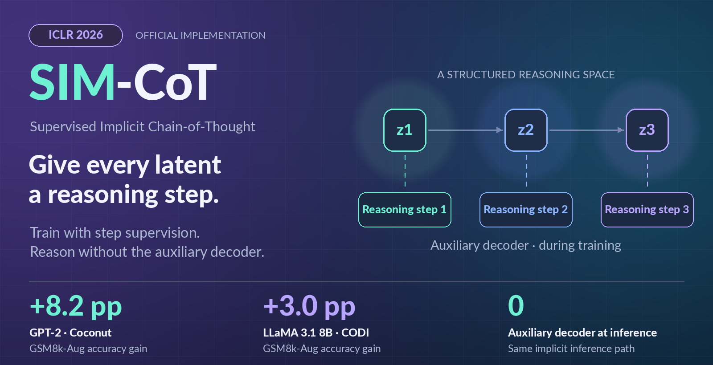
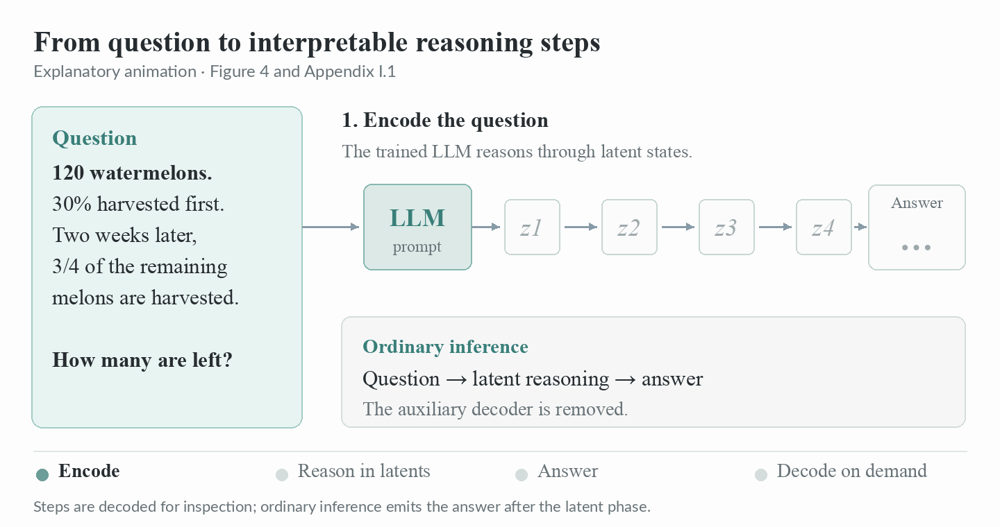
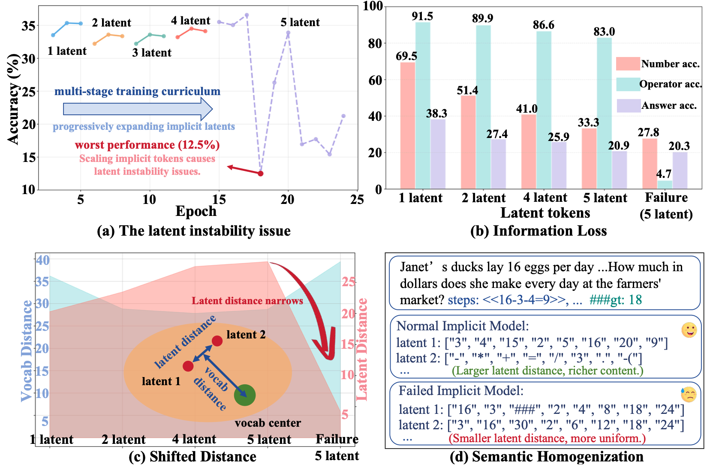
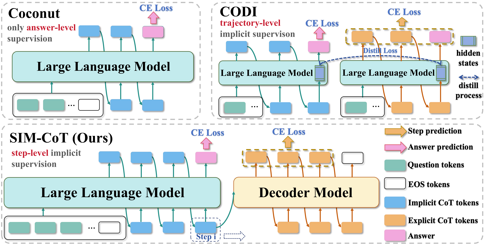
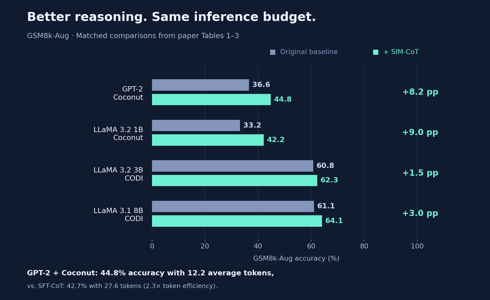
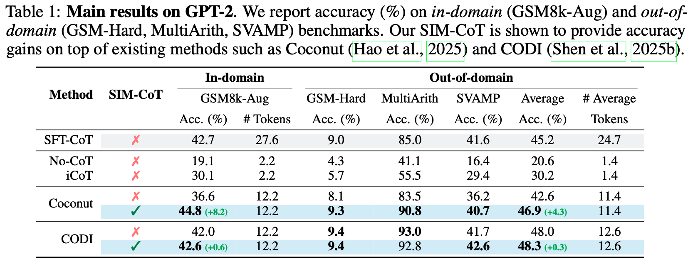
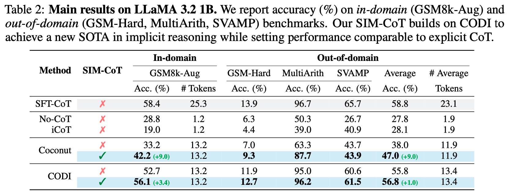
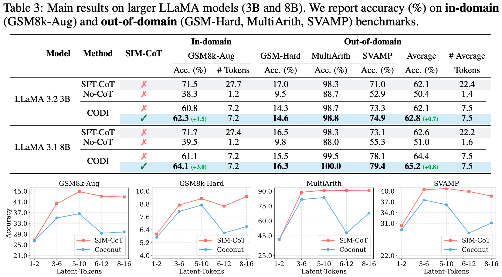

<p align="center">
  <a href="assets/readme/hero.png"></a>
</p>

<h1 align="center">SIM-CoT</h1>
<p align="center"><strong>Supervised Implicit Chain-of-Thought · ICLR 2026</strong></p>

<p align="center">
  <a href="https://arxiv.org/abs/2509.20317">Paper</a> ·
  <a href="https://sim-cot.github.io/">Project page</a> ·
  <a href="https://huggingface.co/collections/Wiselnn/sim-cot-supervised-implicit-chain-of-thought-68d895b00576f6166c19ab4f">Models</a> ·
  <a href="LICENSE">Apache 2.0</a>
</p>

<p align="center">
  <a href="#demo">Demo</a> ·
  <a href="#method">Method</a> ·
  <a href="#results">Results</a> ·
  <a href="#quickstart">Quickstart</a> ·
  <a href="#citation">Citation</a>
</p>

SIM-CoT adds **step-level supervision** to implicit reasoning methods such as
Coconut and CODI. An auxiliary decoder learns to recover each reasoning step
from its corresponding latent during training. Remove the decoder at inference
to keep reasoning compact; reuse it when inspecting the learned latents.

## Demo

<p align="center">
  <a href="assets/readme/latent-walkthrough.png"></a>
</p>

*Paper case visualization, based on Figure 4 and Appendix I.1. The animation illustrates latent
reasoning and optional step decoding; it is not a live model run.*
The four steps are shown separately here; Figure 4 combines the two middle steps.
[Static view](assets/readme/latent-walkthrough.png) ·
[Visual sources](docs/readme-visuals.md).

## Method

1. **Identify the instability.** More implicit reasoning steps can make latent
   states homogeneous and cause training collapse.
2. **Supervise each step during training.** An auxiliary decoder predicts the
   *k*-th explicit reasoning step from the *k*-th latent.
3. **Keep inference compact.** Remove the decoder, reason in latents, then
   generate the answer. Reattach the decoder for optional step inspection.

<details>
<summary><strong>Original method and instability figures</strong></summary>

[](assets/simcot_observation.png)

[](assets/simcot_arch.png)

In the GPT-2 scaling study, Figure 3 reports up to **8 latents / 16 implicit
tokens**. Axis labels such as `8–16` denote a latent count and a token count.

</details>

## Results

<p align="center">
  <a href="assets/readme/results-overview.png"></a>
</p>

**GSM8k-Aug accuracy (%)** and average token counts from Tables 1–3.
Token counts are unchanged within each baseline / SIM-CoT pair. Gains are
**percentage points (pp)**:

| Base method | Model | Baseline → + SIM-CoT | Gain | Avg. tokens |
| --- | --- | ---: | ---: | ---: |
| Coconut | GPT-2 | 36.6 → **44.8** | **+8.2 pp** | 12.2 |
| Coconut | LLaMA 3.2 1B | 33.2 → **42.2** | **+9.0 pp** | 13.2 |
| CODI | LLaMA 3.2 3B | 60.8 → **62.3** | **+1.5 pp** | 7.2 |
| CODI | LLaMA 3.1 8B | 61.1 → **64.1** | **+3.0 pp** | 7.2 |

On **GPT-2 / GSM8k-Aug**, Coconut + SIM-CoT also exceeds explicit SFT-CoT by
**2.1 pp** (44.8% vs. 42.7%) with **2.3× token efficiency** (12.2 vs. 27.6;
ratio rounded). This is a token-count comparison. Larger-model in-domain
accuracy remains below explicit SFT-CoT.

<details>
<summary><strong>Full results: in-domain, out-of-domain, and token counts</strong></summary>

The paper evaluates in-domain GSM8k-Aug and out-of-domain GSM-Hard, MultiArith,
and SVAMP. These images retain the full results from Tables 1–3:

[](assets/simcot_experiment1.png)

[](assets/simcot_experiment2.png)

[](assets/simcot_experiment3.png)

For GPT-2, CODI + SIM-CoT improves GSM8k-Aug by **0.6 pp** (42.0% → 42.6%).
The **4.3 pp** result is the OOD average gain of Coconut + SIM-CoT
(42.6% → 46.9%).

</details>

## Quickstart

```bash
git clone https://github.com/InternLM/SIM-CoT.git
cd SIM-CoT
# Install the root requirements for the Coconut implementation.
python -m pip install -r requirements.txt
```

Choose **Coconut** or **CODI** below. Prepare the model, dataset, and checkpoint
paths before launching; the repository contains training code and configurations,
with pretrained checkpoints linked in the [model collection](https://huggingface.co/collections/Wiselnn/sim-cot-supervised-implicit-chain-of-thought-68d895b00576f6166c19ab4f).
The implementations have separate dependency sets; use a dedicated environment
for CODI with [its requirements](CODI/requirements.txt). The Coconut examples use
eight GPU processes in a CUDA environment.

<details>
<summary><strong>Coconut + SIM-CoT: prepare, train, and evaluate</strong></summary>

All commands in this section run from `Coconut/`:

```bash
cd Coconut
bash preprocessing/gsm_icot.bash
```

Prepare the local GPT-2 model at `pretrained/gpt2/`. The preprocessing script
creates `data/gsm_train.json` and `data/gsm_test.json`; each record contains a
`question` string, `steps` list of strings, and `answer` string.

Set literal model, data, and checkpoint paths in the selected YAML configuration
to your actual files. The supplied configurations refer to these checkpoints:

| Configuration | Purpose | Default checkpoint |
| --- | --- | --- |
| [gsm_coconut.yaml](Coconut/args/gsm_coconut.yaml) | Train the Coconut baseline from an explicit-CoT checkpoint. | `ckpts/gsm_cot/checkpoint_20` |
| [gsm_simcot.yaml](Coconut/args/gsm_simcot.yaml) | Continue a Coconut checkpoint with step supervision. | `ckpts/gsm-coconut/checkpoint_24` |
| [gsm_simcot_eval.yaml](Coconut/args/gsm_simcot_eval.yaml) | Evaluate a trained SIM-CoT checkpoint. | `ckpts/gsm_coconut_simcot/checkpoint_30` |

Adjust these references to match your downloaded or trained checkpoints. The
repository's `ckpts/gsm_cot` entry is a placeholder, not usable model weights.

```bash
# Train the Coconut baseline from your prepared CoT checkpoint.
torchrun --nnodes 1 --nproc_per_node 8 run.py args/gsm_coconut.yaml

# Continue from your selected Coconut checkpoint.
torchrun --nnodes 1 --nproc_per_node 8 run.py args/gsm_simcot.yaml

# Evaluate your selected SIM-CoT checkpoint.
torchrun --nnodes 1 --nproc_per_node 8 run.py args/gsm_simcot_eval.yaml
```

To create an explicit-CoT warm start first, configure
[args/gsm_cot.yaml](Coconut/args/gsm_cot.yaml). Set `load_model_path: "None"`
(the quoted string) to skip checkpoint loading; the runner expects this sentinel
rather than YAML `null`. Run that configuration before the Coconut stage:

```bash
torchrun --nnodes 1 --nproc_per_node 8 run.py args/gsm_cot.yaml
```

</details>

<details>
<summary><strong>CODI + SIM-CoT: prepare, train, and evaluate</strong></summary>

Start from the repository root, then use `CODI/` as the working directory:

```bash
# In a separate CUDA environment, install the CODI dependency set.
python -m pip install -r CODI/requirements.txt
cd CODI
```

The bundled launch scripts are configuration examples. Update the model and
checkpoint paths and `SAVE_DIR` for your environment. Dataset and result paths
also appear in [train.py](CODI/train.py) and [test.py](CODI/test.py); replace those
author-specific absolute paths before running.

```bash
# Train CODI + SIM-CoT on GSM8k-Aug with LLaMA 3.2 3B.
bash scripts/train_llama3b_gsm8k-aug-decoder-2.sh

# In a CODI/ terminal with your output path configured, evaluate the checkpoint.
export SAVE_DIR="/path/to/your/results"
bash scripts/test_llama3b-copy.sh
```

The training and evaluation scripts each need the correct local model and
checkpoint paths. Changing a path in the shell script does not update the
separate dataset paths in Python.

</details>

## Authors and affiliations

[Xilin Wei](https://github.com/Wiselnn570), [Xiaoran Liu](https://scholar.google.de/citations?user=Qe6F4J4AAAAJ&hl=en), [Yuhang Zang](https://yuhangzang.github.io), [Xiaoyi Dong](https://lightdxy.github.io), [Yuhang Cao](https://scholar.google.com/citations?user=sJkqsqkAAAAJ&hl=en), [Jiaqi Wang](https://myownskyw7.github.io/), [Xipeng Qiu](https://xpqiu.github.io/en.html), [Dahua Lin](http://dahua.site/)

Fudan University; Shanghai AI Laboratory; The Chinese University of Hong Kong; Shanghai Innovation Institute;

## News

- **2026-01-26:** Accepted to ICLR 2026.
- **2025-09-24:** Paper and code released.

## Citation

<details>
<summary><strong>BibTeX — ICLR 2026</strong></summary>

```bibtex
@inproceedings{wei2025simcot,
  title={{SIM-COT}: Supervised Implicit Chain-of-Thought},
  author={Wei, Xilin and Liu, Xiaoran and Zang, Yuhang and Dong, Xiaoyi and Cao, Yuhang and Wang, Jiaqi and Qiu, Xipeng and Lin, Dahua},
  booktitle={International Conference on Learning Representations},
  year={2026}
}
```

</details>

## Acknowledgments

- [Coconut](https://github.com/facebookresearch/coconut): The codebase we built upon. Thanks for their wonderful work.
- [CODI](https://github.com/zhenyi4/codi): Our work is based on this codebase; we are grateful for their valuable contribution.
- [LLaMA series](https://huggingface.co/meta-llama/collections): The amazing open-sourced large language model!
- [GPT2](https://huggingface.co/openai-community/gpt2): An impressive open-source large language model!

## License

This repository is released under the [Apache License 2.0](LICENSE).
